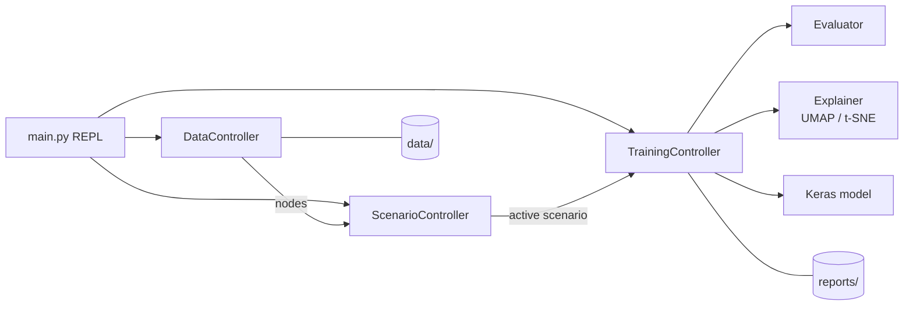

# XTM - eXplainable Travelling Model

[](https://github.com/Racciatti/XTM/actions/workflows/ci.yml)
[](LICENSE)

XTM is a simulation environment for the **travelling model** paradigm of distributed learning. A single
neural network is trained *sequentially* on data partitions owned by different nodes (think hospitals), so
no node's data is ever centralised. After every node, XTM can extract the activations of an inner layer
and project them with UMAP or t-SNE, letting you inspect how the model's internal representation
evolves as it travels, and how noisy or degraded nodes affect it.

## Motivation

Data held by separate institutions often cannot be pooled. In a travelling model the *model* moves
instead of the data. Because weights change only inside one node at a time, each change can be
attributed to a specific node, which makes the process a good fit for explainability studies.
XTM provides a reproducible sandbox for such experiments: partition a dataset, build
(possibly non-IID or corrupted) nodes, define a traversal, train, evaluate and visualise.

## Features

* Dataset partitioning into disjoint subsets: `uniform` or `manual` proportions.
* Node and scenario management (ordered traversal of nodes).
* Data degradation to simulate bad nodes: uniform label noise and Gaussian blur.
* Metrics: accuracy, recall, precision, AUC, F1, F-beta, NPV, evaluated pre/post node and pre/post cycle.
* Feature-space visualisation of the penultimate layer (UMAP or t-SNE) and activation dumps (`.npy`).
* Automatic Markdown reports per experiment; batch experiments from a CSV file.
* Guards against train/test leakage (see [docs/architecture.md](docs/architecture.md)).

## Architecture



Details in [docs/architecture.md](docs/architecture.md).

## Installation

Requires Python 3.12+.

```bash
git clone https://github.com/Racciatti/XTM.git
cd XTM
python -m venv venv && source venv/bin/activate
pip install -r requirements.txt
```

## Quickstart

The example script downloads PneumoniaMNIST (about 4 MB), splits it across 3 simulated hospitals,
trains a tiny CNN for 2 travelling cycles and writes a report:

```bash
python examples/quickstart.py --workdir xtm_demo --nodes 3 --cycles 2 --epochs 1
# add --explain to also produce UMAP plots (slower)
```

Output lands in `xtm_demo/reports/quickstart.md` (plus plots and activations). The script is a
compact reference for the programmatic API.

## CLI usage

Run the interactive REPL from the directory where you want `data/`, `reports/` and `system_state/` to live:

```bash
python main.py
```

Commands have a long form and a short alias. Controller state is saved on `exit`/`q` and restored on the next start.

| Area | Commands (alias) |
|---|---|
| Data | `add dataset` (ad), `create subsets` (cs), `create harmful datasubset` (chds), `create node` (cn), `add subset to node` (as), `remove node/dataset/datasubset` (rn/rd/rds), `remove datasubset from node` (rdsfn), `edit dataset/datasubset/node` (edd/edds/edn), `view data` (vd) |
| Scenario | `create scenario` (csc), `add node to scenario` (ans), `remove node from scenario` (rns), `set node order` (sno), `set active scenario` (sas), `edit/remove scenario` (edsc/rsc), `view scenarios` (vs) |
| Training | `add model` (am), `set active model` (sam), `reset model weights` (rmw), `get architecture` (ga), `configure evaluation` (ce), `configure explanation` (cexp), `set explanation timings` (set), `train current node` (tcn), `train scenario cycle` (tsc), `train n scenario cycles` (tnc), `run from file` (rff), `view metrics` (vm), `view training` (vt), `advance scenario` (adv), `reset scenario` (rs) |

Typical session: `add dataset` -> `create subsets` -> `create node` + `add subset to node` (per node) ->
`create scenario` -> `add node to scenario` -> `set active scenario` -> `add model` -> `set active model` ->
`configure evaluation` -> `train n scenario cycles`.

### Datasets

Datasets are directories in one of two layouts:

* MedMNIST style: `train_images.npy`, `train_labels.npy`, `test_images.npy`, `test_labels.npy` (optional `val_*`, merged into training).
  `examples/quickstart.py` shows how to convert a MedMNIST download to this layout. Only this layout can currently be trained and evaluated.
* One sub-directory per class (partitioning only).

### Models

Models are Keras 3 `.keras` files, compiled with a categorical cross-entropy loss and a softmax output. The model
should accept the raw `.npy` image arrays (include any rescaling/reshaping as layers, as the quickstart does).
Labels are one-hot encoded automatically.

### Batch experiments

`run from file` reads a CSV with the columns `cycles,epochs,scenario,model,report_name` and runs one
experiment per row, producing one report each:

```csv
cycles,epochs,scenario,model,report_name
3,1,demo,demo_cnn,exp_a
5,2,demo,demo_cnn,exp_b
```

## Configuration

There are no config files; behaviour is configured through commands or the Python API:

* Evaluation metrics and timings: `configure evaluation` (`pre-node`, `post-node`, `pre-cycle`, `post-cycle`).
* Explanation: method (`umap`/`tsne`), layer index (default `-2`), UMAP parameters, data fraction, timings.
* Training: epochs and batch size per node, passed to the train commands.
* Storage: all paths are relative to the current working directory (`data/`, `reports/`, `system_state/`).

## Extending

See the "Extending" section of [docs/architecture.md](docs/architecture.md) for adding perturbations, metrics and CLI commands.

## Development

```bash
pip install -r requirements-dev.txt
ruff check .
pytest
```

## Limitations

* Sequential traversal only; `random` traversal order is accepted but not implemented (nodes are always visited in order).
* Training and the global test set support the MedMNIST `.npy` layout only. The test set is the original test split of the source dataset(s), not per-node.
* Class weights are computed from the first subset of a node, assuming a uniform partition.
* `apply_gaussian_blur` uses pure NumPy loops and is slow for large images.
* State is persisted with `pickle`: only load state files you created yourself, and expect them to break across code changes.
* Research prototype: single-user CLI, no GUI or experiment tracking integration.

## License

MIT, see [LICENSE](LICENSE).
